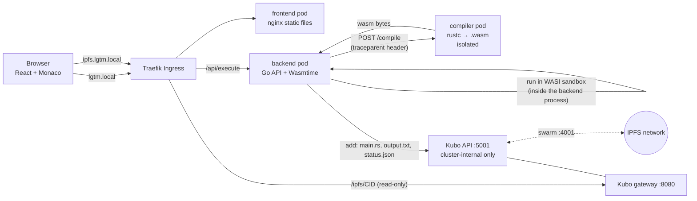
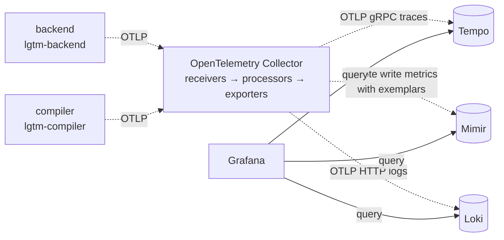

*This project has been created as part of the 42 curriculum by taebkim, yuhyoon.*

# LGTM — Looks Good To Monitor

## Description

LGTM is a Rust playground that you can fully observe. In the browser you write a single-file Rust program and press **Run**. The backend compiles it to WebAssembly (`wasm32-wasip1`), runs it in a locked-down WASI sandbox, uploads the source, the output and a `status.json` to a self-hosted IPFS node, and returns a share link. Every step of that flow is traced, measured and logged with OpenTelemetry, and you can follow a single request from a metric spike to its trace to its log lines in Grafana with a few clicks.

**Goals**

- *Functional:* safe remote code execution and IPFS sharing.
- *Learning:* build the three observability signals (logs, metrics, traces) and the correlation between them, and be able to explain each concept (observability, WASM/WASI, IPFS, OpenTelemetry).
- *Operations:* one `make` on a freshly created Debian 13 VM brings up everything. No cloud services are used.

**Feature overview**

| Area | What it does |
|---|---|
| Frontend | Monaco editor (bundled locally, no CDN), example code, Run button, spinner, compile/runtime errors, output, IPFS link |
| Backend (Go) | `POST /api/execute`: size check, bounded queue, compile, Wasmtime execution, output capture, IPFS upload |
| Compiler pod | `rustc` for a single file, isolated in its own pod ([Security model](#security-model)) |
| IPFS | Kubo node, read-only gateway at `ipfs.lgtm.local`, swarm port 4001 mapped to the VM |
| Observability | OpenTelemetry Collector → Tempo (traces), Mimir (metrics), Loki (logs); Grafana with two provisioned dashboards |
| Infra | k3d (k3s + Traefik) inside one VM, driven entirely by the `Makefile` |

## Instructions

### VM

| | Recommended | Minimum |
|---|---|---|
| CPU | 4 cores | 2 cores |
| RAM | 8 GB | 8 GB |
| Disk | 40 GB (dynamic) | 30 GB |

- Intel/AMD PC: Debian 13 `amd64` netinst ISO.
- Apple Silicon Mac: [UTM](https://mac.getutm.app/) with Debian 13 `arm64` netinst ISO.
- ISOs: <https://cdimage.debian.org/debian-cd/current/>. The Makefile detects `amd64` / `arm64` automatically.

### Install and run

Requirements: a user that can run `sudo`, and Internet access for the first `make` (apt packages, the Docker/kubectl/Helm/k3d binaries, container images and the Rust/Go/Node base images are downloaded).

> **sudo on a fresh Debian:** if you set a root password during installation, the first user is *not* in the `sudo` group (and `sudo` may not be installed). Either leave the root password empty when installing Debian, or run `su -c 'apt install -y sudo && usermod -aG sudo <user>'` and log in again.

Inside the VM:

```bash
sudo apt install -y make git fonts-noto-cjk
git clone <this repository> lgtm && cd lgtm
make
```

After the install, open a new terminal and then run `make`.

`make` asks for the sudo password **once, right at the start**, and then runs `install`, `hosts`, `cluster`, `build` and `deploy` in that order. All sudo use (apt, Docker, the binaries in `/usr/local/bin`, `/etc/hosts`) happens in `install` and `hosts`, well inside sudo's 15-minute timestamp, so it does not ask again later. It installs Docker, kubectl, Helm, k3d and the Korean font `fonts-noto-cjk` at pinned versions, writes the host names to the VM's `/etc/hosts`, creates the k3d cluster, builds the `backend`, `compiler` and `frontend` images locally and imports them into k3d (nothing is pushed to a registry), and deploys observability → IPFS → app. No re-login is needed after Docker is installed. Every target is idempotent, so running `make` again is safe (if the sudo timestamp has expired it asks for the password once more). The run ends with `ingress ready: lgtm.local`.

Start over: `make fclean` removes the cluster, the locally built images and the `/etc/hosts` block; `make re` does `fclean` and then `make`.

After a VM reboot: `make install` enables Docker at boot, and `scripts/verify/m6-02-fresh-vm.sh` checks the restart policy of the k3d node containers. Log in after the reboot and run `scripts/tools/reboot-check.sh`; it passes when all pods are Running and `lgtm.local` answers 200 within 3 minutes of boot (verified on a separate VirtualBox amd64 VM, 2026-10-25).

### Addresses (open them in Firefox **inside the VM**)

| URL | What |
|---|---|
| <http://lgtm.local> | The playground |
| <http://grafana.lgtm.local> | Grafana (anonymous Editor access; the admin password is a random Secret created by `make deploy`) |
| <http://ipfs.lgtm.local/ipfs/CID/> | Local IPFS gateway for a CID returned by the playground |

`make hosts` maps these three names to `127.0.0.1` in the VM's `/etc/hosts`, which is why the demo is done with a browser in the VM.

### Optional: use a browser on the host PC

Not needed for the demo, and not covered by `make verify`. On the host, add the VM's IP to the host's `/etc/hosts`:

```
<VM-IP> lgtm.local grafana.lgtm.local ipfs.lgtm.local
```

Verified: from the Mac, the VM's UTM Shared address (192.168.64.x) is reachable over ssh. Not verified: opening the sites in a host browser after editing the host's `/etc/hosts`. If the VM is not reachable by IP, forward the VM's port 80 to the host and use the forwarded port. Public IPFS access additionally needs port 4001 (tcp and udp) forwarded, see [IPFS and NAT](#ipfs-and-nat).

## Architecture

Request flow (solid) — what happens when you press Run:



Telemetry flow — how a request becomes metrics, traces and logs:



- Wasmtime is not a separate pod: it runs inside the backend process. Only `rustc` is split out into the compiler pod.
- The backend sends a W3C `traceparent` header to the compiler, so the `compile` span in `lgtm-compiler` and the spans in `lgtm-backend` form one distributed trace.
- Collector → Tempo/Mimir/Loki is *ingest*; Grafana → Tempo/Mimir/Loki is *query*. Manifests are in `k8s/observability/`, for example `k8s/observability/collector.yaml`.
- `ipfs.lgtm.local` goes from Traefik straight to the Kubo gateway, not through the backend. The Kubo API (5001) is a ClusterIP Service protected by a NetworkPolicy that only admits the backend.

## Technical choices

| Topic | Choice | Why |
|---|---|---|
| Local Kubernetes | k3d v5.9.0, k3s `v1.37.1-k3s1` | Light, Traefik ingress included. Port 4001 must be mapped at cluster creation (it cannot be added later) |
| Manifests | Raw YAML under `k8s/`, applied by `make deploy` | Mimir's official chart targets distributed mode, which is too heavy for an 8 GB VM |
| Language to run | Rust, target `wasm32-wasip1` (`rust:1.99.1-slim-trixie` image) | Compiles to WASI directly |
| Backend | Go 1.27.3 | Mature OpenTelemetry Go SDK |
| WASI runtime | Wasmtime via wasmtime-go v50.0.0 (cgo) | Store memory limiter and epoch interruption; the build image therefore needs gcc |
| Frontend | React 19.3.1, Vite 8.3.5, Monaco 0.57.0, nginx-unprivileged 1.31.7 | Monaco is bundled locally, no runtime CDN |
| Compile | Single-file `rustc` in a separate pod | Rules out `build.rs` and proc-macros; the pod boundary handles the rest ([Security model](#security-model)) |
| Traces | Tempo 3.1.0 | TraceQL, trace-to-logs |
| Metrics | Mimir 3.2.2, monolithic mode, filesystem storage, one pod | Distributed mode does not fit the VM |
| Logs | Loki 3.7.9, native OTLP ingestion | No deprecated Loki exporter needed |
| Collection | OpenTelemetry Collector contrib 0.163.1 | `receivers → processors → exporters` maps directly onto the OTel concepts |
| Dashboards/UI | Grafana 13.2.4, provisioned from files only | Datasources and dashboards are never configured by hand |
| IPFS | Kubo v0.43.1 | Failed runs are uploaded too (with `status.json`), so a link alone shows the result |
| Images | Pinned in `k8s/images.txt` (no `:latest`), prefetched with retry | Reproducible builds; `scripts/images/check-images.sh` checks that manifests, Dockerfiles and the Makefile agree with it |
| Log path | OTLP (carries `trace_id` / `span_id`) plus JSON on stdout | Correlation in Grafana, and `kubectl logs` for debugging |
| Trace dashboard data | App histogram + exemplars for the time series; Tempo only for Longest/Slowest | Cheap, and exemplars give the metric → trace jump |

Pinned tool versions (Makefile): k3d v5.9.0, kubectl v1.37.1, Helm v3.22.1, Docker 29.9.1.

## Security model

User code is untrusted, and its output is pinned on our IPFS node, and once someone else has fetched it, it cannot be reliably taken back. So there are two separate boundaries: the **run** boundary (WASI sandbox) and the **compile** boundary (compiler pod).

### Run: WASI sandbox (inside the backend, `backend/internal/wasmexec/wasmexec.go`)

| Limit | Value | How |
|---|---|---|
| Network | none | No socket capability is granted |
| Filesystem | none | No preopened directories; no inherited env or args |
| Memory | 10 MiB | Wasmtime store limiter |
| Time | 5 s wall-clock | Epoch interruption, ticked every 100 ms |
| Output | 10 KiB total (stdout + stderr) | `fd_write` is replaced by a Go function that writes into capped in-memory buffers; excess is dropped and `truncated` is set. Nothing is written to disk |
| Request body | 64 KiB | `413` before the body is read |
| Concurrent runs | 2, queue 8 | The 11th concurrent request gets `429`; waits are capped at 45 s |
| Compile time | 15 s | `rustc` is killed and reported as a compile error |
| IPFS upload | 10 s | After that the result is returned without a link |

Acceptance cases covered by `scripts/verify/`: infinite loop → timeout, 100 MB allocation → `memory_limit`, `std::fs::read("/etc/passwd")` fails, `TcpStream::connect` fails, 1 MiB output → truncated at 10 KiB, 20 concurrent requests → 10 served, 10 rejected with `429`.

### Compile: isolated compiler pod (`k8s/app/compiler.yaml`)

The WASI sandbox only protects execution. `rustc` itself will happily run `include_str!("/etc/passwd")`, `env!("SECRET")` or `#[path = "/proc/self/environ"] mod x;` at compile time, outside the sandbox. Hence:

- Only `rustc` and the wasm target are in the image; nothing worth reading is there.
- `automountServiceAccountToken: false`, `runAsNonRoot: true`, all capabilities dropped, `readOnlyRootFilesystem: true` with an `emptyDir` workspace that is created per request and deleted afterwards.
- `rustc` runs with an explicit five-variable environment (`PATH`, `RUSTUP_HOME`, `CARGO_HOME`, `HOME`, `TMPDIR`); nothing is inherited.
- NetworkPolicy: ingress only from the backend; egress only to DNS (53) and the Collector's OTLP port (4317).
- Resource limits: 2 CPU / 2 GiB for the pod, which serves at most 2 concurrent compiles.

### Deny-list and bypass experiments

On top of isolation, the compiler rejects sources before `rustc` runs (`backend/internal/compile/denylist.go`). Rules: `include_str!` / `include_bytes!` / `option_env!` / `include!`, `env!`, renaming them with `as`, `mod name;` (file modules), `#[path]` and `cfg_attr(... path = ...)`, and `.incbin`. It checks both the raw source and a comment-stripped view. `include!` is not in the original requirements; it was added because it can print file contents inside `rustc` error messages.

A pattern list is not a complete defence, and this was checked rather than assumed. Experiments with a local `rustc` (not on the VM) showed these forms compile and expand, so a plain `include_str!` match alone would miss them: `r#include_str!`, `std::r#env!`, `use std::env as e; e!(..)`, `include_str /* /* */ */ !(..)` (nested comments), macro parameters (`m!(include_str)`), and `#[cfg_attr(all(), path = "...")] mod x;`. The rules above were designed against those forms. The list is still regex-based, so it can both over-block (`println!("include_str!")` is rejected) and, in principle, under-block. **The final defence is the isolation layer**, not the deny-list.

### NetworkPolicy control experiments

A policy that "seems" to work proves little, so the verify scripts use a control group: connect from a pod that should be blocked (fails), temporarily delete the policy and connect again (**succeeds**, proving the block was the policy and not something else), restore the policy and connect again (fails). This is done for the compiler pod (`scripts/verify/m2-02-compiler-hardening.sh`) and the Kubo API (`scripts/verify/m3-01-kubo-node.sh`). The backend's reaction to a blocked Kubo API is checked in `scripts/verify/m3-02-ipfs-upload.sh`.

## Observability

**Signals**

- *Metrics* (Mimir): `lgtm_executions_total{status}`, `lgtm_execution_duration_seconds` (histogram with exemplars), `lgtm_stage_duration_seconds{stage}` (compile, execute, ipfs, queue), `lgtm_output_bytes`, `lgtm_queue_rejected_total`, `lgtm_queue_active`, `lgtm_queue_waiting`. No label carries a CID, hash or any other high-cardinality value.
- *Traces* (Tempo): root span `POST /api/execute` with children `compile` (including the compiler's `rustc` span), `execute` and `ipfs.upload`. Root attributes include `lgtm.status`, `code.sha256` and `ipfs.cid`.
- *Logs* (Loki): structured logs sent through the OpenTelemetry slog bridge, so every line carries `trace_id` and `span_id`.

**Correlation**

1. **Metric → trace (exemplar).** Histogram points carry the `trace_id` of a sample request; clicking a dot on the duration graph opens that trace in Tempo.
2. **Trace → logs.** The Tempo datasource is provisioned with trace-to-logs: in a span, "Related logs" (the assignment's "Logs for this span") queries Loki with `trace_id` and `span_id`.
3. **Logs → trace.** A derived field on the Loki datasource turns `trace_id` in a log line into a link to the trace.

**No user input in telemetry.** Trace error events and logs contain only fixed, classified messages (for example `rustc failed [E0425]`, `source denied [deny-env-macro]`, `exit code 3`, `time limit exceeded`), never source text, compiler output or program output. To see what actually ran, take the `ipfs.cid` attribute from the span and open `http://ipfs.lgtm.local/ipfs/<cid>/`: `main.rs`, `output.txt` and `status.json` are there. This keeps the telemetry stores free of user strings and keeps metric cardinality bounded.

**Dashboards** (provisioned from `dashboards/`, uids `lgtm-metrics` and `lgtm-traces`; edits in the UI are not saved, change the JSON and run `make deploy`):

- *LGTM Metrics* (`dashboards/lgtm-metrics.json`): success / failure / total counts, 429 rejections, p95 duration with exemplars, per-stage p95, status ratio, queue activity, output size distribution.
- *LGTM Traces* (`dashboards/lgtm-traces.json`): p95 and mean duration with exemplars, Longest duration (Tempo TraceQL metrics), Slowest executions table (TraceQL search, sorted by duration), failed traces table.

## IPFS and NAT

**What works.** Each run uploads `main.rs`, `output.txt` and `status.json` (also for failed runs) to the in-cluster Kubo node and returns a CID. `http://ipfs.lgtm.local/ipfs/<cid>/` serves it from the local gateway. The gateway is read-only, and `ipfs.lgtm.local/api/v0/*` is not exposed.

**What does not (in the tested environments).** Opening the same CID on a public gateway needs a public node to fetch the blocks from our node over the IPFS swarm, which means our port 4001 must be reachable from the internet. A VM behind NAT is not reachable: Kubo reports AutoNAT `Private`, has no public direct address, and only advertises relay (`/p2p-circuit`) addresses. Port 4001 is mapped from the VM into the k3d node, but the VM sits behind UTM's NAT and, behind that, the router.

**Diagnosing: `make ipfs-check`.** It is deliberately not part of `make`, because it depends on the network and takes about 1.5 minutes. It prints `S1`…`S9` checks (S1 VM-internal 4001, S2 swarm peers, S3 our addresses, S4 AutoNAT, S5 test file add + pin + provide, S6 local gateway, S7 delegated routing advertisement, S8 an external probe, S9 five public gateways), then one summary line:

```
SUMMARY first_blocked=<vm-4001|utm|router|internet|none|unknown> reason=...
```

`vm-4001` is proven; `utm` and `router` are *inferred* from the VM's default gateway, because the layers beyond the VM cannot be inspected from inside it.

**Measured results** (raw output kept in `docs/evidence/`):

| Network mode | Result | Evidence |
|---|---|---|
| UTM *Shared* (NAT, gateway 192.168.64.1) | `first_blocked=utm` (inferred); AutoNAT Private; public gateways 0/5 | [ipfs-check-utm-shared-20261023.txt](docs/evidence/ipfs-check-utm-shared-20261023.txt) |
| UTM *Bridged* (LAN, gateway 10.143.2.1) | `first_blocked=router` (inferred); AutoNAT Private; public gateways 0/5 | [ipfs-check-utm-bridged-20261023.txt](docs/evidence/ipfs-check-utm-bridged-20261023.txt) |

Bridged removes the UTM layer, but the router would still have to forward 4001 (tcp and udp) to the VM. AutoNAT still reported `Private` and the CID did not open on any public gateway, which is consistent with 4001 not being reachable from outside the LAN (inferred, the router was not inspected). With Shared networking you need two forwards (UTM and router); UTM documents port forwarding only for the QEMU backend in Emulated VLAN mode ([UTM docs](https://docs.getutm.app/settings-qemu/devices/network/port-forwarding/)). In both runs the node did obtain relay addresses and was advertised to delegated routing with relay addresses only, but no tested public gateway or independent node fetched the file (in the F-M3-03 experiments an independent Kubo node sometimes connected through the relay yet received no blocks; the cause was not determined).

**About the gateways themselves.** The result is not only NAT:

- `ipfs.io`: plain HTTP requests get `429` with the body "switching to a service worker gateway only", and a browser-like request got `403`. This is independent of NAT. The gateway is moving to a service worker gateway; browser behaviour was **not measured** here (curl only). See <https://gatewaychanges.ipfs.io>.
- `dweb.link`: DNS lookup failed from the VM.
- `gateway.pinata.cloud`: actually searched the network and timed out. This is the only meaningful negative result.
- `trustless-gateway.link`, `4everland.io`: gateway-side errors (522 / 504).
- The external reachability probe backend could not be reached from the VM (timeout), so that step is reported as `SKIP`.

Subject authors confirmed (world_beta, 2026-10-23) that explaining a campus network limitation is acceptable, and that a service worker gateway such as inbrowser.link or any public gateway may be used instead of ipfs.io.

The playground's public link therefore points to `https://inbrowser.link/ipfs/<cid>` instead of `ipfs.io` (whether it opens there was **not measured** here; it still depends on our node being reachable).

To show a working public fetch in a defence you need a network where the router can forward 4001 (or another network where inbound connections work). Otherwise present the `make ipfs-check` output and explain the layer that blocks.

## Demo walkthrough

1. Open <http://lgtm.local> in the VM's Firefox. Press **Run** on the example a few times; also try an infinite loop (`loop {}` → "Time limit exceeded (5s)"), `vec![0u8; 100_000_000]` (memory limit) and a program that prints a lot (truncated at 10 KiB).
2. Wait about 30 seconds so the metrics are exported to Mimir (the backend pushes every 5 s) and visible.
3. Open <http://grafana.lgtm.local> → **LGTM Metrics**. Show the success/failure counts and the p95 duration graph.
4. Click an **exemplar** dot on the duration graph → the **trace** opens in Tempo (`POST /api/execute` → `compile` → `rustc` → `execute` → `ipfs.upload`; two services in one trace).
5. In a span click **Related logs** (the assignment's "Logs for this span") → the Loki lines for exactly that span.
6. Copy `ipfs.cid` from the span attributes and open `http://ipfs.lgtm.local/ipfs/<cid>/` → the exact `main.rs`, `output.txt` and `status.json` of that run. The trace itself never contained the user's text.
7. After about 1 minute open **LGTM Traces**. Slowest executions and the p95/mean graphs (exemplars) are available immediately. **Longest duration** (TraceQL metrics) lags by roughly 50 seconds after a new trace (one measurement); open the longest trace from the Slowest table, because the Longest panel's exemplar is not necessarily the maximum.

## Make targets

| Command | What it does |
|---|---|
| `make` | `sudo-auth` (asks the sudo password once) + `install` + `hosts` + `cluster` + `build` + `deploy` |
| `make install` | Install Docker, kubectl, Helm, k3d (pinned, idempotent, arch-aware) and `fonts-noto-cjk` |
| `make cluster` | Prefetch k3s/k3d images, create the k3d cluster (80/443 and 4001 tcp/udp mapped) |
| `make images` | Prefetch all external images and import the workload images into k3d |
| `make build` | Build backend, compiler and frontend images locally (the frontend build runs lint and tests) and import them into k3d |
| `make deploy` | Apply observability → IPFS → app manifests, create the Grafana admin Secret if missing, load `dashboards/*.json`, wait for readiness |
| `make hosts` | Write the three host names to `/etc/hosts` (managed block, one copy) |
| `make status` | Nodes, pods and ingresses |
| `make verify` | Run all `scripts/verify/*` checks in order, stopping at the first failure (VM/Linux only; takes several minutes) |
| `make verify-m1` | Only the first-milestone checks |
| `make ipfs-check` | IPFS and NAT diagnosis, see [IPFS and NAT](#ipfs-and-nat) (not part of `make`) |
| `make clean` | Delete the k3d cluster (leaves `/etc/hosts` and images alone) |
| `make fclean` | `clean` + remove the locally built `lgtm-backend` / `lgtm-compiler` / `lgtm-frontend` images + remove the `/etc/hosts` block (external images, apt packages and binaries stay) |
| `make re` | `fclean`, then `make` |

Iterating after a code change: `make build deploy` is enough; `make re` is only for a from-scratch check.

**Rolling restarts.** Right after a rollout, requests used to hang for exactly 30 s and end in a `504`: Traefik was slow to drop the old pod's endpoint, so it kept sending requests to a terminating pod whose SYN packets were discarded. The backend and frontend pods now have a 10 s `preStop` sleep (and the backend a longer termination grace period and shutdown limit), so the old pod keeps serving until Traefik has caught up. `scripts/verify/m6-04-stability.sh` restarts each deployment while sending requests and requires zero non-200 responses; it passed twice after the fix. The upper bound of Traefik's delay was not measured (10 s is a margin), and replicas above 1 or a heavily loaded node were not tested.

## Known limitations

- **NAT / public gateways:** see [IPFS and NAT](#ipfs-and-nat). Public IPFS access is not available behind NAT without port forwarding, and `ipfs.io` no longer answers plain HTTP requests.
- **A new cluster shows `NaN` / empty p95 panels at first:** `rate()` needs at least two samples per histogram series, so the panels fill in after a second batch of requests (about 20 seconds later).
- **Longest duration panel lags** by roughly 50 seconds (TraceQL metrics, one measurement).
- First `make` needs internet access to pull images and packages; image pulls are retried (`scripts/images/prefetch-images.sh`).

## Resources

**Documentation and references**

- OpenTelemetry: <https://opentelemetry.io/docs/>, [Prometheus and OpenMetrics compatibility](https://github.com/open-telemetry/opentelemetry-specification/blob/v1.40.0/specification/compatibility/prometheus_and_openmetrics.md)
- Grafana: [Tempo data source (trace-to-logs, exemplars)](https://grafana.com/docs/grafana/v13.2/datasources/tempo/configure-tempo-data-source/), [Mimir deployment modes](https://grafana.com/docs/mimir/v3.2.x/references/architecture/deployment-modes/), [Migrate to Tempo 3](https://grafana.com/docs/tempo/v3.1.x/set-up-for-tracing/setup-tempo/migrate-to-3/)
- Loki: <https://grafana.com/docs/loki/latest/>
- WebAssembly / WASI / Wasmtime: <https://webassembly.org/>, <https://wasi.dev/>, <https://docs.wasmtime.dev/>, <https://github.com/bytecodealliance/wasmtime-go>
- IPFS: <https://docs.ipfs.tech/>, [libp2p circuit relay v2](https://raw.githubusercontent.com/libp2p/specs/master/relay/circuit-v2.md), [public gateway changes](https://gatewaychanges.ipfs.io)
- UTM networking: <https://docs.getutm.app/settings-qemu/devices/network/port-forwarding/>
- k3d / k3s: <https://k3d.io/>, <https://docs.k3s.io/>
- Go `log/slog`: <https://pkg.go.dev/log/slog>

### Use of AI

The author designed the project skeleton and its core logic before any code was written: the directory layout, the service boundaries (backend, isolated compiler, IPFS node, observability stack), the API and its status model, the request pipeline (queue → compile → execute → IPFS upload), the sandbox and resource limits, and the span and metric structure. All of this is written down in the PRD. AI (Claude Code) then wrote the code from that design, under rules the author set, and every plan and result went through the author's review before it was merged. Commit trailers (`Co-Authored-By`) and `docs/HANDOFF.md` record who did what.

**Design and decisions (author)**
- **Stack**: Rust compiled to WASM and run under WASI with wasmtime-go, k3d, the LGTM stack behind a single OpenTelemetry Collector, raw manifests instead of Helm.
- **Security model**: the execution limits (10 MiB memory, 5 s, 10 KiB output, 64 KiB request body, 2 running + 8 queued), the two-layer defense for the compile step (a source deny-list, with pod isolation as the final layer), the NetworkPolicy scope, and the rule that no user input appears in traces or logs.
- **How the work was delivered**: the project was split into features across milestones M0–M6. Each feature had a written scope, an out-of-scope list, and acceptance criteria that could be checked by running a command.
- **Engineering rules**, kept in `CLAUDE.md`: a failing verify script is committed before the implementation; only commands actually run on the VM count as verified; one VM lock across parallel sessions; every make target idempotent; no manual configuration (Grafana only through provisioning files); any deviation from the PRD is stopped and asked as an explicit "PRD change".
- **Review**: every implementation plan was approved or sent back before coding started, and every result was reviewed before merging.
- **Hands-on checks**: the manual scenarios in the VM's Firefox (limit cases in the playground, and metric → exemplar → trace → logs → IPFS), the IPFS reachability test on a campus network with UTM Bridged networking, the fresh-VM run on a separate VirtualBox (amd64) machine, and the question to the subject authors about the public gateway requirement.

**Implementation (Claude Code)**
- Wrote the code, Kubernetes manifests, Makefile, scripts and verify scripts from the design above, ran them on the VM, and reported each result as claim / how it was checked / result. Counted with `git log` on `origin/main` at commit `4d34bde`, 89 of 93 non-merge commits carry the trailer `Co-Authored-By: Claude Sonnet 5.5` (the other 4 are the first commit and three `CLAUDE.md` rule updates).

**Review partner (Claude, chat)**
- Used to draft and challenge the PRD, the per-feature prompts, and the plan and result reviews, and to compare technical options. Final decisions and approvals were made by the author.
